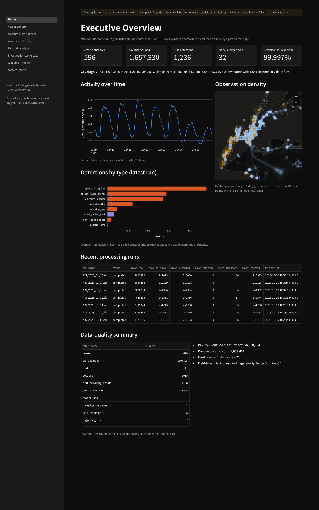
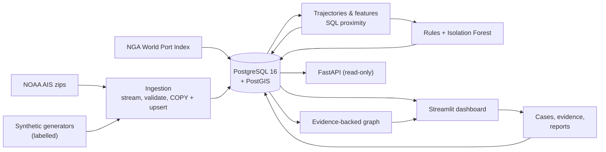
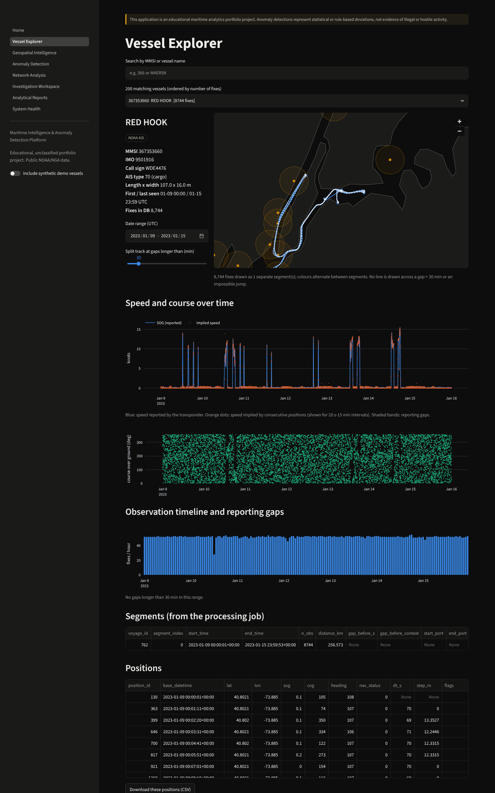
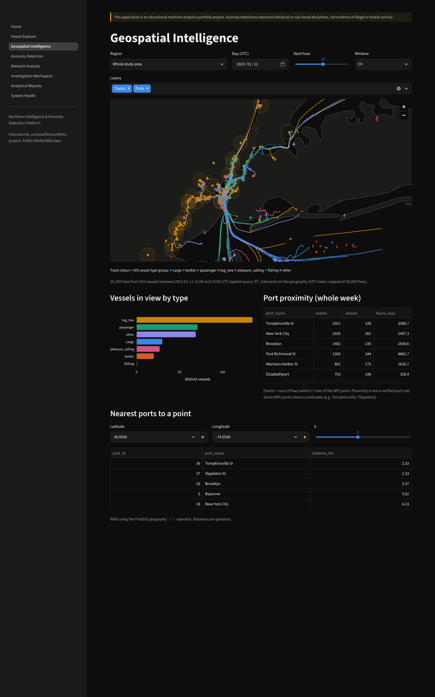
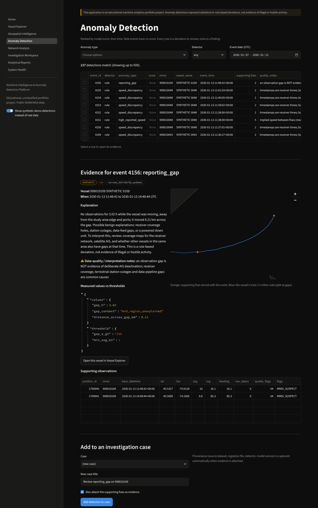
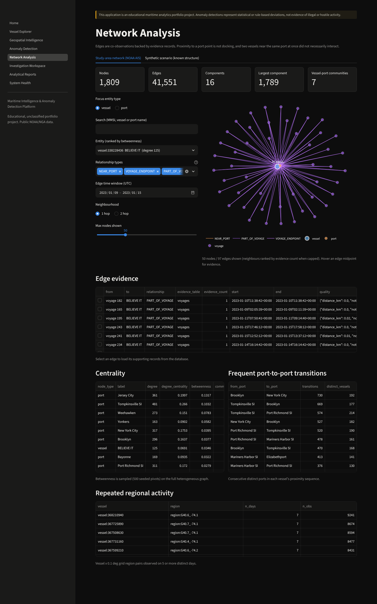
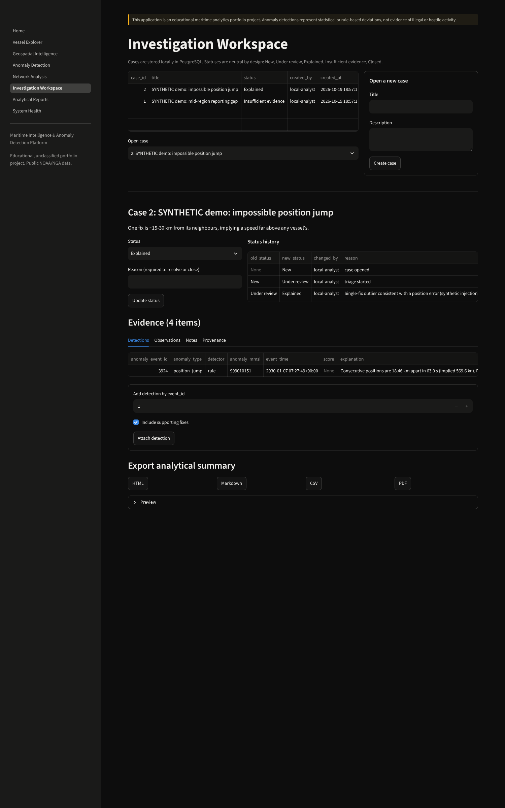
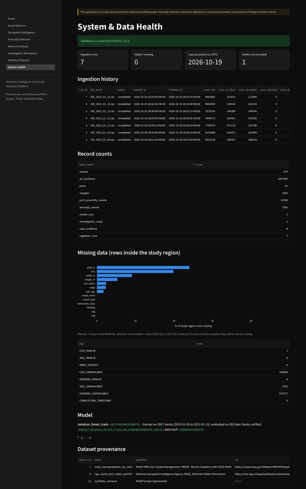

# Maritime Intelligence & Anomaly Detection Platform (MIADP)

> **Disclaimer:** This application is an educational maritime analytics portfolio project.
> Anomaly detections represent statistical or rule-based deviations, not evidence of
> illegal or hostile activity.

An end-to-end analytics platform built on **real NOAA AIS data** for New York Harbor
(Jan 9-15 2023). It ingests and validates raw vessel reports into PostgreSQL/PostGIS,
reconstructs trajectories, measures port proximity, flags unusual movement and reporting
patterns with explainable rules and an Isolation Forest, builds an evidence-backed
vessel/port network, and gives an analyst a Streamlit investigation workspace and a
read-only FastAPI backend.

Independently developed, unclassified, public data only. Not affiliated with any company
or agency.



## Why this project

Large sensor datasets are only useful if someone can find the few records worth looking
at and trust *why* they were surfaced. One week of AIS for one harbour is 55.8 million
nationwide rows. MIADP turns that into ranked, explainable leads, each tied to the exact
observations behind it, and says plainly what those leads are not. That combination
(data engineering, geospatial SQL, careful ML evaluation, and analyst-facing tooling with
provenance) is the core of forward-deployed and intelligence-analysis data work.

## What it does (all measured on the real week)

| stage | result |
|---|---|
| Ingestion | 7 NOAA daily files (2.2 GB), **55,755,505** raw rows scanned, **1,657,330** positions loaded for **596** vessels; 0 hard rejects, 71 duplicates; idempotent and resumable |
| Trajectories | 1,844 segments; 1,245 gaps > 30 min classified (733 in port, 381 mid-region, 131 near the study-area edge) |
| Port proximity | 41 NGA World Port Index ports; proximity events computed in SQL (`ST_DWithin` + gaps-and-islands) |
| Detection | 7 configurable rules (1,236 real-data events) + Isolation Forest on 2,592 vessel-day tracks (32 flagged for review) |
| Evaluation | synthetic labelled benchmark: rules F1 0.98; model average precision 0.87; real data: seed Spearman 0.99, KS drift p = 0.07 |
| Network | 1,809 nodes / 41,551 evidence-backed edges; centrality, Louvain communities, port-to-port transitions |
| Analyst tools | 8-page dashboard, case management with provenance, HTML/MD/CSV/PDF reports, 11 read-only API endpoints |
| Quality | 80 automated tests (unit + PostGIS integration + API), Ruff, CI workflow |

## Before publishing to GitHub

Run the offline publication safety check:

```bash
python tasks.py publish-check
```

This checks tracked files (or all source files in an exported ZIP) for common private key files, suspicious credential strings, and files larger than 25 MiB. It exits nonzero if an issue is found. **Review its findings manually:** this is a heuristic safeguard, not a comprehensive secret scanner or proof that the project is production-ready. Never commit `.env`, raw AIS downloads, database exports, or credentials. Confirm that any screenshots and public data comply with their source terms.

To publish, create a new GitHub repository, push the source code, and verify that GitHub Actions CI passes. The application requires PostgreSQL/PostGIS and source datasets for a full live demonstration; the screenshots in this README are not a hosted deployment.

## Architecture



More detail: [docs/architecture.md](docs/architecture.md).

## Technology

Python 3.12 · pandas · NumPy · PyArrow · SQLAlchemy 2 · psycopg 3 · PostgreSQL 16 ·
PostGIS 3.4 · Alembic · Pydantic 2 · GeoPandas · Shapely · pyproj · scikit-learn · SciPy ·
NetworkX · Streamlit · Plotly · PyDeck · FastAPI · Uvicorn · pytest · Ruff · Docker
Compose · GitHub Actions · ReportLab.

## Data sources

| source | publisher | use |
|---|---|---|
| [Marine Cadastre AIS 2023](https://coast.noaa.gov/htdata/CMSP/AISDataHandler/2023/index.html) | NOAA OCM / BOEM (USCG NAIS) | vessel positions, Jan 9-15 2023 |
| [World Port Index, Pub. 150](https://msi.nga.mil/Publications/WPI) | NGA Maritime Safety Information | port reference points |
| [Natural Earth 1:10m land](https://www.naturalearthdata.com/downloads/) | Natural Earth (public domain) | map context only |
| Synthetic generators (`src/maritime/synthetic.py`) | this project | tests, labelled benchmark, demo cases |

The 2024 NOAA files listed on the index returned HTTP 404 when this was built, so the
study uses 2023. Hashes, schemas, transforms and limitations:
[docs/data_sources.md](docs/data_sources.md).

## Screenshots (real, captured from the running app)

| | |
|---|---|
| Vessel Explorer: gap-aware tracks, reported vs implied speed |  |
| Geospatial Intelligence: tracks by vessel type, port proximity |  |
| Anomaly Detection (synthetic demo data): evidence, thresholds, quality notes |  |
| Network Analysis: focused, evidence-backed neighbourhoods |  |
| Investigation Workspace: cases, evidence, provenance, export |  |
| System & Data Health |  |

Map backgrounds use the bundled Natural Earth outline; online CARTO basemap tiles also
load when the browser has internet access. Detection screenshots use the synthetic demo
slice so no real vessel is presented as an outlier.

## Quick start (Windows PowerShell)

```powershell
git clone <your-repo-url> maritime-intelligence; cd maritime-intelligence
py -3.12 -m venv .venv; .\.venv\Scripts\Activate.ps1
python tasks.py setup                 # install + create .env (then set POSTGRES_PASSWORD)
python tasks.py db-up                 # PostGIS in Docker, bound to 127.0.0.1  (or use a native install)
python tasks.py migrate
python tasks.py download              # ~2.2 GB NOAA AIS for Jan 9-15 2023
curl.exe -L -o data\reference\UpdatedPub150.csv "https://msi.nga.mil/api/publications/download?type=view&key=16920959/SFH00000/UpdatedPub150.csv"
python tasks.py synthetic --load      # labelled synthetic fixtures + demo slice
python tasks.py pipeline              # ingest -> ports -> process -> detect -> evaluate -> network
python tasks.py app                   # http://127.0.0.1:8501
python tasks.py api                   # http://127.0.0.1:8000/docs
```

Or the full stack: `docker compose up --build`. Full instructions, native PostgreSQL
setup, shutdown and cleanup: [docs/deployment.md](docs/deployment.md).

## Example analytical workflow

1. **Executive Overview:** coverage, activity by hour, density, detection counts, run
   history.
2. **Anomaly Detection:** filter by type/time, select a detection, read its measured
   values vs thresholds, the plain-language explanation and data-quality notes, and the
   supporting fixes on a map with 2 h of context.
3. **Vessel Explorer:** open the vessel, see segments split at gaps, reported vs implied
   speed, reporting timeline.
4. **Network Analysis:** see which ports and vessels it shares evidence-backed
   co-observations with; click an edge to load the underlying proximity events.
5. **Investigation Workspace:** attach the detection and fixes to a case, add notes,
   move it to *Explained* or *Insufficient evidence* with a reason, export a report with
   sources and limitations. Two sample cases on synthetic vessels:
   [reports/sample_investigations/](reports/sample_investigations/).

## Machine learning methodology (summary)

- Unit: vessel-day track; 22 movement, trajectory, geospatial and reporting features.
- Time split: train Jan 9-13, evaluate Jan 14-15; preprocessing fitted on training data
  only; synthetic data excluded and kept from influencing features.
- `IsolationForest(n_estimators=300, contamination="auto", random_state=42)` after median
  imputation and robust scaling; score = `-score_samples`; review threshold = 99th
  percentile of training scores (a review budget, not a base rate).
- Labelled metrics only on the synthetic benchmark; stability diagnostics on real data.
- [Model card](reports/model_cards/isolation_forest_v1.md) ·
  [full methodology](docs/methodology.md) ·
  [exploration notebook](notebooks/01_data_exploration.ipynb).

## Network analysis methodology (summary)

Nodes for vessels, ports, 0.1° grid regions and port-touching voyages; edges
`NEAR_PORT`, `IN_REGION`, `PART_OF_VOYAGE`, `VOYAGE_ENDPOINT`, `SHARED_PORT_PROXIMITY`
(≥ 15 min overlap). Each edge carries evidence ids, time interval, source dataset and
quality metadata; edges without evidence are refused. Degree and seeded sampled
betweenness centrality, connected components, Louvain communities on the vessel-port
subgraph, frequent port transitions, repeated regional activity. A synthetic scenario
with a known answer is recovered in tests and in the UI.

## Limitations

One week and one harbour; terrestrial AIS only; self-reported static data; WPI ports are
coarse points; thresholds are heuristics; the benchmark is author-designed; Docker
Compose and CI are written but were not executed in the build environment. Full list:
[docs/limitations.md](docs/limitations.md).

## Security

Credentials only from environment variables (`.env` is git-ignored; `.env.example`
documents them). All services bind to 127.0.0.1. Parameterized SQL everywhere. The API is
read-only with page-size and time-range caps and no bulk export. Not hardened for public
deployment (no auth, TLS or rate limiting).

## Testing

```powershell
python tasks.py test        # 80 tests; DB tests need the miadp_test database and are SKIPPED otherwise
python tasks.py test-unit   # unit tests only, no database
python tasks.py lint        # ruff check + format check
```

Coverage: column normalization, rejects and flags, MMSI preservation, missing optional
fields, idempotent and crash-resumed loads, schema/constraints, spatial SQL, haversine vs
WGS84, antimeridian handling, segmentation, implied speed, proximity, each rule, model
reproducibility and serialization, leakage-free splits, graph construction and evidence,
centrality on known graphs, API validation/pagination/errors, cases, provenance and reports.

## Performance (measured)

Single runs on a 2-vCPU, 8.4 GB RAM Linux cloud VM, PostgreSQL 16.15, 1.70 M positions
([reports/benchmarks/results.md](reports/benchmarks/results.md),
[sql/explain/SUMMARY.md](sql/explain/SUMMARY.md)):

| operation | result |
|---|---|
| Ingest one NOAA day (8.3 M raw rows, 327 MB zip) | 86.5 s (~96k raw rows/s) |
| Trajectory retrieval, one vessel (≤ 5,000 fixes, with LAG + ST_Distance) | median 18 ms over 20 vessels |
| Spatial bbox + 3 h window | median 138 ms |
| Port KNN (k = 5) | median 2.4 ms |
| Port proximity for the whole table (SQL) | 14.5 s |
| Trajectory steps / track features (pandas) | 7.2 s / 21.3 s |
| Dashboard overview load (headless Chromium) | 11.7 s cold cache, 1.2-5.7 s cached |

## Future improvements

More weeks and seasons; satellite AIS for coverage-aware gaps; terminal and anchorage
polygons; analyst feedback to calibrate thresholds; daily table partitions; Parquet +
DuckDB feature computation; streaming ingest; authentication for multi-user cases.

## Repository guide

`src/maritime/` library · `api/` FastAPI · `app/` Streamlit · `alembic/` migrations ·
`sql/` analytical queries and EXPLAIN plans · `config/thresholds.yaml` · `tests/` ·
`scripts/` (benchmarks, screenshots, notebook, sample cases) · `docs/` (architecture,
data sources, dictionary, methodology, limitations, API, deployment,
[interview walkthrough](docs/interview_walkthrough.md),
[implementation status](docs/implementation_status.md)).

## License

MIT (see [LICENSE](LICENSE)). Data remains subject to its publishers' terms.
