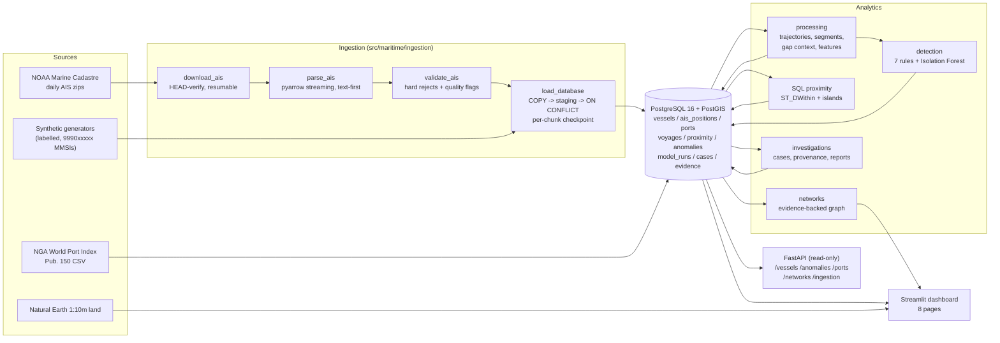

# Architecture

## Layers

| layer | code | responsibility |
|---|---|---|
| Config | `src/maritime/config.py`, `config/thresholds.yaml`, `.env` | all tunables: DB, dates, bbox, thresholds |
| Storage | `alembic/`, `src/maritime/database.py` | schema migrations, pooled engine (UTC sessions) |
| Ingestion | `src/maritime/ingestion/` | download, parse, validate, load, quality report, ports, Natural Earth |
| Processing | `src/maritime/processing/` | pure-pandas trajectory and feature code + DB job |
| Detection | `src/maritime/detection/` | rules, Isolation Forest, explanations, evaluation, DB job |
| Networks | `src/maritime/networks/` | graph build, metrics, Plotly rendering, DB job |
| Investigations | `src/maritime/investigations/` | cases, evidence with provenance, reports (HTML/MD/CSV/PDF) |
| Queries | `src/maritime/queries.py` | every parameterized analytical query used by API, UI and reports |
| API | `api/` | FastAPI app, Pydantic schemas, routes, structured errors, request logging |
| UI | `app/` | Streamlit pages + shared components |
| CLI / tasks | `src/maritime/cli.py`, `tasks.py` | `python tasks.py <command>` (Windows-friendly) |

## Design decisions

- **Pure functions + thin DB jobs.** Trajectory, feature, rule and model code take
  DataFrames, so the same code runs on the DB extract, the synthetic benchmark and unit
  tests. DB jobs only read, call, and upsert.
- **SQL where the database is better.** Proximity uses PostGIS indexes and window
  functions; the per-vessel trajectory in the UI and API uses `LAG` + `ST_Distance`.
- **Idempotency everywhere.** Natural unique keys on every table that a job writes, so
  every command is safe to re-run.
- **Provenance by construction.** Each position knows its source and ingestion run; each
  detection stores supporting position ids; each graph edge stores evidence ids; each
  case evidence row stores provenance captured when it was attached.
- **Synthetic isolation.** Synthetic rows are flagged at the source level and excluded
  from real-data figures, model training, density features and the real network.
- **Read-only API.** No unauthenticated write surface; case editing is local.

## Data flow sizes (real week)

55.8 M raw rows scanned -> 1.66 M positions (596 vessels) -> 1,844 segments, 14,798
proximity events (incl. synthetic demo) -> 2,787 vessel-day tracks -> 1,236 rule events
+ 32 model-flagged tracks (real) -> graph of 1,809 nodes / 41,551 edges.
